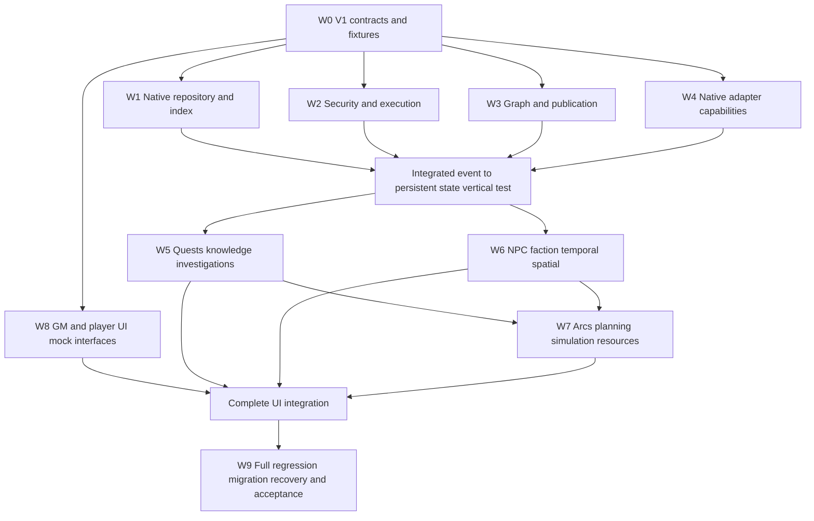

# Easy Plots — Complete-Module Technical Specification

**Document:** EP-SPEC-V1-DRAFT-0.2  
**Status:** Consolidation baseline; normative proposals awaiting actual Foundry v14 integration verification  
**Decisions:** ADR-001 through ADR-125 accepted, discovery closed  
**Target:** One **complete** Easy Plots module for Foundry VTT v14+, developed as coordinated parallel workstreams, integrated and tested incrementally. **Not a feature-limited MVP final deliverable.**  
**Deployment:** Foundry module exclusively; no separate backend/server/remote database/background worker.  
**Authority:** Eligible GM Foundry client for protected evaluation and consequential execution; Foundry server persists allowed native document operations, but is **not** presumed to run custom module logic.  
**Reference provenance:** See `Decision_Register_125.csv`, `Traceability_Matrix.csv`, `Assumptions_and_Spikes.md`, official documentation listed at the end.

> **Status distinction:** Accepted *architectural intent* is authoritative. The concrete TypeScript models, paths, storage partition layouts, capacity budgets, protocol semantics and suggested implementations in this draft are **proposed technical contracts** until checked and approved against target Foundry builds. They are not descriptions of existing code.

## 0. Scope and interpretation

This package converts 125 approved architectural choices into (1) domain requirements; (2) stable V1 contract candidates; (3) component ownership and dependency ordering; (4) full-scope coordinated development plan; (5) testable acceptance criteria; (6) explicitly tracked uncertainties. The final delivery contains **all** approved narrative domains, not merely the introductory vertical slice. Internal vertical slices are **integration/debugging checkpoints** and may be implemented concurrently behind ready contracts. A slice is not a separately marketed release. The package is an initial *specification baseline*, not proof of implementation.

**Non-negotiable invariants:**

- INV-AUTH: a player browser never becomes an authoritative narrative executor; consequential changes require eligible GM control and Foundry-native permissions.
- INV-SECRET: private facts, rule conditions, actor/persona secrets and GM-only metadata never enter unauthorized player-readable documents, payloads, indices, sockets, errors or telemetry.
- INV-NATIVE: Foundry-native Document and Compendium persistence and native client hooks; no custom external server, database, browser-service backend or unattended off-world task execution.
- INV-LAZY: no complete-world graph hydration at startup or during ordinary events; bounded partition/index access, explicit resource budgets and fail-closed exhaustion.
- INV-CAUSAL: canonical event and operation IDs; revision checks; idempotency/verification attempts; durable event and effect journals; no claim of universal atomic or exactly-once cross-document writes.
- INV-PUBLISH: drafts, immutable published contracts and activation are distinct; activation rechecks readiness; only published contracts drive live structural evaluation.
- INV-KNOW: truth, belief, evidence, disclosure and observer-specific projections stay distinct; no answer-oracle behavior.
- INV-HISTORY: authoritative current world facts can change without rewriting historical provenance, old arc resolutions or past events.
- INV-DELIVERY: one integrated full-scope module delivered via coordinated batches/agents and continuous integration testing; do not treat deferred development ordering as removed requirements.

## 1. Source-of-truth hierarchy and change governance

1. Accepted ADR-001–125 + final scope clarification: authoritative behavioral decisions.
2. This specification's approved normative requirements and invariants: consolidated executable meaning.
3. Versioned contracts and machine-validated schemas: precise interface definition.
4. Traceability matrix: mapping between decisions, contracts, ownership, and acceptance evidence.
5. Implementation internals: free to evolve if externally observable contract semantics remain intact.

An ambiguity becomes `OPEN` in the assumptions log. Two genuine conflicts require explicit decision amendment and impact analysis; the latest convenient implementation does not silently override accepted intent. Each change request records `changeId`, impacted ADR/REQ/contract IDs, migration notes, threat-model review, tests, approval, and target revision. Keep separate **draft** vs **published** specifications.

### 1.1 Document set

- `Easy_Plots_Technical_Spec_v0.2.md`: main consolidated baseline (this file).
- `Contracts_V1_Proposed.ts`: normative-shape **proposals** for all major persisted and API types, not yet compile-certified against Foundry APIs.
- `Decision_Register_125.csv`: every accepted question mapped to domain and historical topic.
- `Traceability_Matrix.csv`: requirement-to-decision-to-owner-to-contract-to-test coverage.
- `Assumptions_and_Spikes.md`: unresolved Foundry/platform and design details with verification method.
- `Workstreams_and_Tests.csv`: coordinated feature batches with dependencies, ownership and testing gates.

The exhaustive record of original Q1–125 answer wording is **not fully available in this consolidation context**; ADR-001–112 use condensed previously recorded summaries, and ADR-113–125 use accepted decision details. Reconcile against complete transcripts before declaring exact historical wording audited.

## 2. Domain decomposition and scope inventory

### 2.1 Foundation

- Stable narrative IDs separate from optional native UUID bindings; aliases, redirects and provenance-preserving rebinding.
- Typed graph with nested subgraphs, typed ports, conditional and event/data/flow edges, execution layers and publishable revisions.
- Canonical typed event stream, separate narrative state, causality, time and independent knowledge/disclosure events.
- Foundry repository façade, GM-only compartmentalization, versioned documents, journals, reverse references, compact tiered indices, bounded caches.
- GM authority, Actor-scoped permissions and player intent requests; protected GM-only source and recipient-specific sanitized projections.
- Effect capability registry, native document adapters, journaled staged multi-document operations, verification and reconciliation.
- Hook/event router with dormant subscriptions, co-GM coordination, bounded scheduler and selective startup/catch-up.
- Preflight, immutable published graph snapshots, activation and migrations; tracing, diagnostics, performance budgets, repair tools.

### 2.2 Full narrative capability domains (all included in final deliverable)

| Domain | Required complete-module capabilities |
|---|---|
| Plots and quests | Layered graphs, subgraphs, conditional branching, qualified milestones, quest projections, closure, mutually exclusive outcomes, cross-plot dependencies |
| Knowledge and investigation | Canonical truth, rumors/false beliefs, observer-specific knowledge, evidence graphs, player review boards, hypotheses, competing theories, credibility, disclosure and correction propagation, viability analysis |
| Factions and reputation | Membership, rank, renown, agendas, bounded faction reactions, pressure/threat clocks and interpersonal obligations |
| NPCs and identity | NPC agendas/schedules, personas, aliases, succession, observer-specific relationships, debts, alliances, location ties |
| Space, time and encounter | Locations/routes/discovery, fiction/execution/knowledge timelines, branch previews, time jumps, encounters and native system roll adjudication |
| Players and GM workflow | Knowledge-safe affordances, structured/freeform intents, voting, offline/quorum policies, attempt identity, GM queue, approvals, dock/inspector/full canvas, attention and notifications |
| Planning and simulation | Session planner, GM cockpit, explainable health/reachability, what-if simulation, narrative foresight, forecast freshness, reviewed recaps |
| Resources and blueprints | Native document preparation, reusable graph blueprints, versioned inheritance, three-way merge, resource ownership, provenance, rebind and repair |
| Campaign continuity | Canonical world entities, alternate conclusions, arc resolution contracts, epilogues, unresolved obligations, continuity manifests, dormant sequel hooks |
| Development and operations | Extensible node/provider manifests, developer test lab, integrity audit, migration, release evidence, explicit compatibility matrix |

**Feature completeness is distinct from exposing all subsystems in one screen.** Each domain needs discoverable GM workflows, native integrations where feasible, clear handling of unsupported system capabilities, diagnostics and acceptance evidence.

## 3. Module boundaries and dependency rule

**Foundry module** `easy-plots`; recommend ES-module TypeScript source compiled to browser-compatible JavaScript. All features live in this installable module package; repository subdirectories/packages are source organization, not separate deployables.

```text
module.json, styles, templates, lang
  -> bootstrap/lifecycle, platform detection, adapter registry
  -> security/authorization + protected projection + intent gateway
  -> repository + index services + identity registry
  -> schema validation + graph contract registry + published configuration
  -> event router + evaluator + temporal scheduler + operation coordinator
  -> effect provider registry + native Foundry adapters
  -> narrative domains: plots/quests, knowledge, factions, people, spatial,
     investigations, encounters, planning, arcs, continuity, simulation
  -> GM/player ApplicationV2 UI + diagnostics + developer test lab
```

**Dependency inversion rules:**

1. Domain engines depend on repository, security, event, graph and capability **interfaces**, not on UI classes or direct document storage internals.
2. UI never directly writes authoritative narrative records; call versioned intents/commands and show sanitized results.
3. Domain adapters never use arbitrary browser eval; conditions are validated declarative AST or explicitly sandboxed provider evaluation with strict registry.
4. Only the repository/adapters invoke native `getDocuments`, `getIndex`, `Document.update` and actual Foundry APIs.
5. Effect providers cannot write arbitrary unrelated world state; each declares authority, resource types, validation, idempotency strategy and verification semantics.
6. Simulation does not invoke live effect providers; use read-only snapshots and mock effects.
7. Player clients only consume eligible projections; raw GM-only records and even their identifiers must not be exposed through broad collections.
8. Sockets are notification/intent transport **only** where sender identity and transport confidentiality can be supported and verified. A generic module socket is not a secret/secure identity primitive.

### 3.1 Proposed source tree

```text
src/
  bootstrap/{init,ready,teardown,compatibility}.ts
  platform/{foundry-v14,documents,packs,hooks,sockets,world-time}.ts
  contracts/{ids,graph,nodes,events,state,requests,effects,knowledge,
             time,resources,publication,repository,providers}.ts
  security/{principal,permissions,actor-context,authorize,projection,
            secure-transport,secret-audit}.ts
  storage/{repository,partition,records,indices,locks,archive,migrations,
           manifests,consistency}.ts
  graph/{registry,compiler,typed-ports,linking,reachability,evaluator,
         cycles,dependencies}.ts
  runtime/{event-router,subscriptions,causality,operations,journal,
           scheduler,gm-coordination,reconciliation}.ts
  capabilities/{registry,native-documents,rolls,chat,system-adapters}.ts
  domains/
    plots/{nodes,quests,milestones,closure,cross-plot}.ts
    knowledge/{facts,claims,observers,propagation,corrections}.ts
    investigation/{evidence,hypotheses,attempts,boards,viability}.ts
    people/{identity,personas,relationships,obligations,npc-agendas}.ts
    factions/{membership,renown,agenda,clocks,reactions}.ts
    spatial/{regions,locations,routes,discovery}.ts
    temporal/{world-time,timelines,jumps,schedules}.ts
    encounters/{outcomes,check-policy,system-rolls}.ts
    arcs/{resolution,epilogue,legacy,continuity}.ts
    planning/{session,health,foresight,recaps,attention}.ts
    resources/{native-preparation,provenance,rebind,blueprints}.ts
    simulation/{scenario,fork,evaluate,diff}.ts
  ui/
    core/{AppV2Base,rendering,actions,dialogs}.ts
    gm/{graph,inspector,cockpit,approvals,planner,diagnostics}.ts
    player/{quests,clues,knowledge,investigation,intents}.ts
    widgets/{dock,notification,focus}.ts
  devtools/{test-lab,fixture-runner,profile,integrity-report}.ts
  tests/{contracts,unit,foundry-integration,security,failover,
         migration,performance,acceptance}.ts
static/{templates,styles,lang,packs}
build/module.json
```

No shared code outside the deployable module is required. Agents may own isolated source folders but shared `contracts/` and `security/` are write-restricted integration boundaries.

## 4. Canonical identity, storage and indexes

### 4.1 Identifier and reference types

- `NarrativeId`: immutable, opaque string (`ep:<type>:<ULID-or-UUID>`) created locally; uniqueness checked at creation. Avoid deriving identity from user-editable display names or Foundry document IDs.
- `NativeBinding`: optional `{uuid, documentType, bindingStatus, revisionHint, validatedAt}`; may fail or be rebound without changing NarrativeId.
- `IdentityLink`: `{entityId, personaId?, aliasId?, relationType, start?, end?, disclosurePolicy}`. Merges/succession require lineage and GM approval; do not silently combine obligations or memories.
- `ResourceReference`: `{id, resourceType, narrativeId?, nativeBinding?, ownershipMode, sourceEventId?, sourceBlueprint?, status}`.
- Every record: `kind`, `schemaVersion`, `id`, `revision`, `updatedAt`, `partitionId`, `accessClass`, `provenance`, and typed payload.

### 4.2 Storage mapping — proposal, not verified substrate guarantee

Use **Foundry-native world-owned JournalEntry/JournalEntryPage records or controlled world Compendium records**, encapsulated behind `NarrativeRepository`. Favor dedicated **world-owned Compendiums partitioned by domain and sensitivity** if tests prove their access, write and indexing semantics appropriate; alternate using GM-restricted world Journal pages for stores requiring event fan-out. Do not store GM secrets in player-visible Actor/Item flags or documents with public visibility; flags do **not** constitute a secret store simply because the property key is namespaced.

A *registry/settings record* maps partition key to safe pack/journal IDs and index revision. Shard by `{world,domain,arc|entity-bucket,accessClass,timeBucket?}` with adaptive splits when measured size/query budgets require them. Persist only compact **GM-protected** indices (event subscriptions, reverse dependencies, due dates, references, journal operations); derive independent sanitized public indices. Never use an unrestricted all-document `getDocuments()` for normal startup.

**Document access caveat:** Foundry's `CompendiumCollection.getIndex` and `getDocuments` are documented APIs, but pack role-based ownership and metadata visibility require a live GM/player penetration test. Creation of world Compendiums and writable lock behavior must be verified in the target build. Storage remains abstract until SPIKE-STO-001 is passed.

### 4.3 Proposed record groups

| Record kind | Key properties | Access |
|---|---|---|
| PlotDraft | graph data, base revision, author, draft revision | GM/editor |
| PublishedGraph | immutable versioned node/edge contract, linked dependency manifest, hash | GM-authoritative |
| NarrativeEntity | typed facts, native reference, lineage and provenance | GM truth store |
| EventRecord | canonical event + causal/time metadata | GM history |
| StateRecord | entity/plot state, revision, lastAppliedEvent | GM history |
| OperationRecord | requested/authorized effects, attempt, provider verification, status | GM recovery |
| ObserverKnowledge | observer-scope fact/belief, disclosure lineage, credibility | restricted by observer |
| IndexShard | index type/key, postings, revision, checksum and coverage | GM-only or separately sanitized |
| PlayerProjection | explicit allowlisted fields and disclosure revision | recipient-eligible |
| ArcResolution | immutable outcome facets, selected ending, unresolved threads, approval | GM with separate public epilogue |
| ContinuityManifest | compact stable references, activation policies, outdated flags | GM planning |
| ResourceManifest | ownership, native bindings, reverse references, migration/source data | GM records |

### 4.4 Repository API

```ts
interface NarrativeRepository {
  read<T>(id: NarrativeId, ctx: ReadContext): Promise<Revisioned<T> | null>;
  readMany<T>(ids: readonly NarrativeId[], ctx: ReadContext): Promise<ReadonlyArray<Revisioned<T>>>;
  scanIndex(query: IndexQuery, ctx: ReadContext): AsyncIterable<IndexHit>;
  commit(record: RecordMutation, expectedRevision: number, ctx: GMWriteContext): Promise<CommitResult>;
  appendEvent(event: NarrativeEvent, ctx: GMWriteContext): Promise<AppendResult>;
  appendOperation(op: EffectOperation, ctx: GMWriteContext): Promise<AppendResult>;
  resolveBinding(ref: NativeBinding, ctx: ReadContext): Promise<BindingResolution>;
  getPartitionStatus(id: string, ctx: ReadContext): Promise<PartitionHealth>;
}
```

**Semantics:** `read` checks contextual access, returns only one partition-bound record, no auto hydrating descendants. `scanIndex` is bounded by explicit limit/budget and sanitized per requester. `commit` performs read/validate/write/read-back revision verification where atomic compare-and-swap is unavailable; detect and report uncertain races, don't advertise linearizable writes. `appendEvent` is durable append-attempt with causal ID and reconciliation, not guaranteed single atomic transaction. Revision conflicts require GM review/retry, not blind last-write-wins. Deleting native Docs externally marks related bindings stale and triggers scoped repair.

**Index invalidation:** changes append index-delta/intention records; reconcile materialized indices after crash; maintain index coverage/freshness states. L1 memory cache bounds must be configured, measured and partitioned per access scope. No public cache key may alias a protected GM record.

## 5. Graph and rule contracts

### 5.1 Graph document

`NarrativeGraphV1` has `id, schemaVersion, revision, title, rootComponent, layers, nodes, edges, subgraphReferences, requiredCapabilities, visibilityPolicy, entryTriggerIndex, semanticHash, provenance`.

`NodeV1`: `{id, typeId, typeVersion, graphId, label, role: 'narrative'|'logic'|'effect'|'presentation', ports: PortSpec[], data, config, accessClass, parentSubgraphId?, authoredRevision, disabled?}`.

`EdgeV1`: `{id, source:{nodeId,portId}, target:{nodeId,portId}, kind:'flow'|'condition'|'event'|'data'|'relationship', order?, guard?, routePolicy?, accessClass}`. Native graph-editor pixel coordinates are separate UI layout metadata; they are **not** causal program state.

`PortSpec`: `{id, direction:'input'|'output', valueType: registered type, multiplicity, required, disclosureClass}`. A typed graph compiler validates connectivity, unknown node placeholders, cardinality, allowed scope, prerequisites and fan-out budgets. A link does **not** authorize an effect by itself.

**Subgraphs:** stable subgraph ID and revision-bound imported port contract; explicit external inputs/outputs. Lazy resolution through dependency manifest. Cycles require `maxEvaluations`, causality IDs, convergence criteria/terminal state, scheduler budgets; deny unbounded self-trigger loops.

### 5.2 Condition AST

No JavaScript `eval` / `Function` on GM-authored expressions. Use a versioned declarative AST (`all/any/not`, comparison operators, reference reads, status, time, observer-has-knowledge, accepted roll outcome, membership, relationship and provider-specific pure predicates) checked against schema, access permissions and type contracts. Decision on expression grammar and external library deferred to SPIKE-RULE-001. Rule evaluation emits a structured `EvaluationRecord`: input revision IDs, predicate outcome, roll provenance, reason code, knowledge disclosure class, cost and invoked subnodes. The explain-why/why-not interface uses protected projections of those records.

### 5.3 Branch and milestone semantics

Branch policies are explicit: exclusive, first-match, ordered, parallel, quorum, conditional cascade with bounded scheduler, etc. Never infer branch priority from visual position. Quests, milestones and cross-plot consumers subscribe to canonical events via index. Milestone qualification is independent from source event truth and independent from objective/arc closure. A player submitting a correct theory does not itself prove evidence or complete a mystery. One canonical event may qualify many milestones, but each has its own eligibility, visibility, authorization and idempotent award policy.

### 5.4 Graph lifecycle

`draft -> preflight -> approved immutable published revision -> independently activated snapshot -> paused/retired`. Published graph node contracts are frozen under `schemaVersion` and content hash. Cosmetic UI-only changes may be live without changing causal semantics. Structural changes require new candidate and scoped dependency invalidation. Every GM runtime request includes expected published revision and input state revision, revalidated before effect execution. Publication is not the same action as activation.

A publication report records passes/blockers/warnings/unverified coverage, referenced provider and resource revisions, schema checks, scoped reachability, mandatory disclosure validation, GM approval and audit. Unknown required coverage is **not** a pass. GM can acknowledge narrative ambiguity warnings; cannot waive a privacy or unbounded-execution blocker.

## 6. Events, scheduler, authority, requests and effects

### 6.1 Event model

`NarrativeEventV1` is one canonical occurrence, not a transport message. Fields include stable `eventId`, `eventType`, `eventVersion`, world ID, source binding, actor/observer IDs as justified, fictional time vs real time, `causalParentIds`, `originOperationId`, `payload` with strict type and disclosure label, source revision and provenance. A single Foundry Hook may produce a *candidate observation* that is validated and reduced to a canonical event only under appropriate authority. Avoid reinterpreting player-supplied source IDs as authenticated identity.

Distinct streams:

- **Observation/trigger:** untrusted or context-dependent native event candidate.
- **Intent:** request for an authorized operation, not an effect.
- **Canonical narrative event:** immutable validated fact that an action/decision/discovery was established.
- **Knowledge/disclosure event:** what a specific recipient or group learned and how.
- **Operation/effect journal:** staged native mutation, validation, outcome and recovery evidence.

### 6.2 Request lifecycle

`received -> validated -> queued|rejected -> gm-review|auto-approved -> authorized -> executing -> verifying -> completed|failed|uncertain|cancelled`. Actor-delegated permissions, role, ownership, participant state, published revision, player knowledge, deadline/quorum and request identity must be rechecked at execution time. Retry of a transport request is distinct from a new fictional attempt; policies use opportunity ID, changed approach/evidence/participants/time and GM judgment. Error responses must not expose secret invalid target existence, exact hidden thresholds, route count or masked identity.

**Transport hard gate:** official module sockets are broadcast/relayed, and a string `userId` in payload is attacker-controlled. Until a verified Foundry v14 authenticated sender/recipient mechanism is demonstrated, `game.socket` must never be the sole basis for granting privileged actions or transporting secrets. Candidate designs are (a) native user-owned document/flag workflow with server-enforced identity and GM review, (b) verified transport API supplying sender/recipient identity, or (c) redesigned GM-mediated public requests carrying no sensitive data. This is SPIKE-SEC-001, a release blocker for full player interaction. Never implement unauthenticated privileged socket handling as a workaround.

### 6.3 GM coordinator

One eligible GM execution coordinator for an operation at a time, with revision fencing, lease/heartbeat metadata, idempotency checks and reconcile-on-takeover. Foundry may have multiple concurrent GM browsers but **not** a shared atomic coordinator written by custom server code. Design as best-effort serialized authoritative operations with conflict detection and explicit uncertain-state escalation. No absolute exactly-once guarantee; no unattended GM-offline processing. Valid native updates must still pass Foundry permissions.

### 6.4 Operation state machine and journal ordering

`planned -> validated -> authorized -> prepared -> applying -> verifying -> completed` with terminal/exception `denied, failed, uncertain, compensation-proposed, manually-reconciled`. Each intended native mutation has `effectId`, `providerId`, target binding, state expectation, idempotency key, verification plan, recorded native result, and recovery decision. Write *prepare/intention* before native mutation when possible; after a result, verify authoritative state before marking complete. On interruption, inspect native state and operation receipts; never replay merely because acknowledgment was lost. Foundry native batch updates may be used where supported, without implying atomicity across unrelated document operations. Compensating changes require GM-approved new operations and cannot erase history.

### 6.5 Scheduler

Index event subscriptions and due-time buckets. Queries are keyed by trigger type/scope and graph revision; dormant plots remain unloaded until a relevant subscribed event arrives. Ordered priority queues carry cost, source event, target revision, max fan-out/depth and deadline; use budgets and separate review queue for over-budget/ambiguous outcomes. Relative/delayed effects record world-time policy and explicit clock authority. While no eligible GM is active, keep due records pending; process on GM return according to bounded catch-up policy. Time jumps use plans and due-index scans, not day-by-day world simulation. Fictional vs execution vs knowledge chronology are separate indexed views.

### 6.6 API surface — conceptual TypeScript contracts

```ts
interface NarrativeCommands {
  submitIntent(req: PlayerIntentV1, context: UntrustedTransportContext): Promise<PublicRequestReceipt>;
  reviewIntent(id: NarrativeId, action: ApprovalDecision, gm: GMContext): Promise<GMReviewResult>;
  commitNarrativeEvent(input: CanonicalEventInput, gm: GMContext): Promise<EventCommitResult>;
  evaluateTrigger(eventId: NarrativeId, budget: WorkBudget, gm: GMContext): Promise<EvaluationBatch>;
  executeApproved(operationId: NarrativeId, gm: GMContext): Promise<ExecutionResult>;
  reconcile(operationId: NarrativeId, gm: GMContext): Promise<ReconciliationResult>;
}
```

Only internal GM-context code can call protected commands; a public JavaScript module API must not expose GM write contexts or permit client-generated privileged contexts. GM credentials should derive from Foundry's actual session context, not arbitrary input arguments.

## 7. Authorization, knowledge, player projections and native rolls

### 7.1 Principle of least disclosure

Authoritative truth is stored in a GM-authoritative compartment, separate from viewer projections. Observer knowledge is not the same as true world state, and a player's *permission to attempt* does not imply entitlement to see the secret rule that evaluated the attempt. Use allowlist projection builders that produce new objects from permitted fields; do not serialize full records then hide with UI or strip some keys. The group/player/private observer scope, persona and Actor delegation all affect access. All outgoing notifications and chat/journal integrations use projection policies. Avoid secret leaks via counts, IDs, timings, errors, compendium indices and links.

### 7.2 Knowledge model

- `Fact`: canonical GM truth, time-qualified and sourced.
- `Claim`: observer-aware belief about a fact with source, confidence and possible contradiction.
- `Evidence`: record tying observation, provenance, credibility, scope and disclosure event to claims.
- `Disclosure`: authorized transmission to recipients at a moment, with distortion/visibility policy.
- `Hypothesis`: user-authored evidence-linked argument. Player analysis uses only authorized evidence; separate GM analysis compares to protected truth.
- `BeliefRevision`: updates or retractions are *new events* that preserve prior history.
- `Affordance`: knowledge-safe available player action; absence, labels and feedback must not function as a truth oracle.

Information propagation must use bounded communication paths, source fidelity, observer context, explicit delays and GM review thresholds. No universal rumor spread just because actors share a graph.

### 7.3 Native rolls

`CheckPolicy`: `systemId`, adapter version, roll method, visibility (public/gm/blind/authorized recipients), passive/contested/active mode, optional outcome bands, success semantics, origin attempt ID, and separate narrative-disclosure policy. Where unsupported by installed game system, disable capability and surface GM-only diagnostics; do not invent mechanics or automatically roll hidden checks on a player browser. Record native roll result and derived interpretation under separate protected records. Limited or GM-only ChatMessages must be checked for actual supported behavior in target v14 and system build.

### 7.4 Player request API

```ts
interface PlayerNarrativeAPI {
  getProjection(scope: PlayerViewScope): Promise<SanitizedNarrativeView>;
  getAffordances(actorId: string, contextId: NarrativeId): Promise<ReadonlyArray<SafeAffordance>>;
  requestAction(input: SafePlayerActionInput): Promise<PublicRequestReceipt>;
  submitEvidenceLink(input: PlayerEvidenceLink): Promise<PublicRequestReceipt>;
  submitHypothesis(input: PlayerHypothesisInput): Promise<PublicRequestReceipt>;
  castVote(input: VotingIntent): Promise<PublicRequestReceipt>;
}
```

These public calls are **interface goals**, not proof of authenticated transport. Secure submission and recipient-private results remain SPIKE-SEC-001. Player-created content enters a GM-approved or policy-authorized lifecycle and is never directly merged into protected truth.

## 8. Narrative domain models and primary APIs

### 8.1 Quests, plots, investigations and milestones

`Plot` owns graph revision and objective IDs. `QuestProjection` is derived from authoritative conditions and knowledge policy. `Milestone` is a typed contract (`discovery`, `corroboration`, `verified-conclusion`, `decision`, `intervention`, `disclosure`, `failure`) with qualifying event types, prerequisites, scope, visibility, repeat policy and effect intents. Completion != investigation closure != party confidence. `CrossPlotDependency` uses typed semantics `observe|qualify|unlock|reevaluate|aggregate|react` and bounded fan-out. Parent arcs aggregate separately without double-awarding underlying achievements.

Investigation components: clue opportunities, evidence records, authored valid/alternative paths, player theory graph and GM truth graph, deduction reasoning, counterevidence, partial conclusions and deliberate unsolvability/failure. Viability analyses inspect only bounded reachable and declared critical paths. Theory correctness must not leak through objective badges/hidden reward timing. Named ambiguity and incomplete evidence may be legitimate.

### 8.2 Factions, relationships and identity

`FactionState` separates membership, renown, rank and privileges. `Agenda` carries objective, due schedule, secrecy, triggers, priority, conditions and GM escalation thresholds. `Relationship` is directional, with perspective/persona, reputation/obligations and dated history. Identity links distinguish physical actor/entity, public persona, alternate alias, successor and observer perceptions. Merges are GM-authorized lineage operations, not blind relationship score summation. Favor/debt obligations are independent living-world entities and may persist beyond a concluded arc.

### 8.3 NPCs, world-time and spatial

`ScheduleEntry` is a plan/intent, not proof that travel or action succeeded. `Location` hierarchy plus typed route edges and discoverability policies; Region/location is narrative ID first, optional Scene/Region/Token binding second. Temporal plan reads defined due items by index and classifies deterministic transitions, contingent scheduled operations and unknown off-screen events. Resolve under GM authority without inventing history. Three independent chronology projections: world-fiction time, actual execution time and observer knowledge time.

### 8.4 Encounters and system adapters

`EncounterContract` references Foundry combat/scene/Actor resources, outcomes, qualifying event types and review criteria. Native roll/check adapters provide system-qualified capabilities (e.g. dnd5e separately) without hardcoding every system into the narrative engine. Do not auto-declare victory from a combat end hook without defined outcome policy. Secret contested checks and partial bands require isolated roll provenance and protected outcome interpretations.

### 8.5 Campaign arcs, endings and future continuity

`ArcResolutionContract` includes mutually exclusive primary ending alternatives, compatible independent secondary facets, prerequisites, alternate/partial/failure outcomes, unresolved thread ledger, disclosure constraints, approval and downstream effect intents. A historical `ArcResolutionRecord` is immutable. Living world state continues; current entity references resolve on demand. `ContinuityManifest` is a GM-curated compact list of stable world entities, obligations, unresolved hooks, source arcs and activation policies; referencing a dormant hook does **not** launch a sequel. Epilogues are GM-reviewed knowledge-safe narratives grounded in authorized events; no invented events or automatic historical rewriting.

### 8.6 Planning, simulation, foresight and resource tools

Session plans and GM cockpit combine pinned stories, due review, approvals, narrative health, faction pressure, unresolved plot outcomes, player contributions, and reviewed recap. Forecasts are bounded, explainable candidate outcomes keyed by dependency revision; they are not automatic effects. Isolated what-if timelines fork evaluation state without mutating canonical history. Resource planner stages Foundry document preparation with reuse/provenance, borrowed/shared/exclusive/detached ownership, GM edits protected, three-way blueprint merges, selective adoption and reviewed deletion. Integrity audit includes orphan, broken, duplicate and drift detection with GM-guided rebind; no destructive auto-fix.

### 8.7 Domain command interfaces (illustrative signatures)

```ts
interface PlotService {
  publish(graphId: NarrativeId, draftRevision: number, gm: GMContext): Promise<PublicationResult>;
  activate(graphRevisionId: NarrativeId, gm: GMContext): Promise<ActivationResult>;
  evaluateMilestone(eventId: NarrativeId, milestoneId: NarrativeId, gm: GMContext): Promise<MilestoneEligibility>;
  resolveArc(arcId: NarrativeId, outcome: ArcResolutionProposal, gm: GMContext): Promise<ArcResolutionResult>;
}
interface KnowledgeService {
  compareHypothesisForGM(hypothesisId: NarrativeId, gm: GMContext): Promise<ProtectedAnalysis>;
  prepareDisclosure(eventId: NarrativeId, recipientIds: readonly string[], gm: GMContext): Promise<DisclosurePlan>;
  projectForViewer(scope: ViewerContext, ids: readonly NarrativeId[]): Promise<SanitizedNarrativeView>;
}
interface TimeService {
  planJump(from: number, to: number, scope: ScopeRef, gm: GMContext): Promise<TimeTransitionPlan>;
  commitJump(planId: NarrativeId, decisions: readonly GMTransitionDecision[], gm: GMContext): Promise<TransitionResult>;
}
interface ResourceService {
  prepare(proposal: ResourcePreparationProposal, gm: GMContext): Promise<StagedResourceManifest>;
  reconcileReferences(scope: ScopeRef, gm: GMContext): Promise<ReferenceAudit>;
}
```

## 9. Extension and capability contract

`ProviderManifestV1`: `providerId`, `version`, `requiredFoundryRange`, `supportedSystemIds/versions`, `nodeTypes`, `actions`, `readScopes`, `nativeCapabilities`, `requiredPermissions`, `compatibility`, `lazyEntrypoint`. Registration occurs during module lifecycle, but provider implementation is loaded only when required. Unknown provider/node versions render preserved non-executable placeholders. Migrations convert old payloads only after GM-approved and tested plans.

Supported boundaries:

- **Node provider:** typed schema/ports, pure condition evaluator or explicit approved action class.
- **Effect provider:** input schema, authority, native target resolution, precheck, apply, verify, compensating-proposal and idempotency policy.
- **System adapter:** roll, Actor/Item metadata, activity/combat integration and capability discovery; absent support = no silent fallback.
- **Display extension:** secured projection UI only, never raw GM repository internals in player contexts.

```ts
interface EffectProvider<I, O> {
  readonly manifest: CapabilityManifest;
  validate(input: I, ctx: GMEffectContext): Promise<ValidatedEffect<I>>;
  apply(input: ValidatedEffect<I>, ctx: GMEffectContext): Promise<O>;
  verify(input: ValidatedEffect<I>, result: O | null, ctx: GMEffectContext): Promise<EffectVerification>;
  proposeCompensation?(input: ValidatedEffect<I>, ctx: GMEffectContext): Promise<CompensationProposal>;
}
```

Third-party extensions cannot be considered safely sandboxed merely because they implement an interface: arbitrary JavaScript loaded in a GM browser shares client privileges. The provider registry controls official runtime entry points, but untrusted code is an installation trust issue outside the module's protection. Document this and do not promise security isolation that a browser module cannot provide.

## 10. UI specification — one consistent interaction model

All major interfaces are Foundry `ApplicationV2`-based and dockable where supported; existing non-AppV2 Foundry components can be wrapped only through verified adapters. GM and player interfaces are **different projections** of authoritative data, not a shared raw graph with visibility toggles.

**GM primary workspace:** resizable layered graph (density and zoom), typed palette, inspector (schema, dependencies, permissions, published state), build/validate/publish/activate actions, breadcrumbs for subgraphs, guarded undo, accessible labels, keyboard shortcuts, multi-GM conflict banners and focused diagnostics. Live cosmetic edits do not modify the published semantic hash. Partial graph loading surfaces placeholders without automatically fetching the entire campaign.

**GM cockpit:** active plots, deadlines, faction pressures, approvals, queued effects, unknown execution, pinned attention, session planning, reports and low-overhead notifications. Prominence derived from GM review/pins, verified narrative significance and appropriate decay—not solely noisy event counts.

**Player experiences:** quest journal, evidence board, player hypotheses, authorized clue cards, permissible Actor actions, structured intent forms, party voting and private/party knowledge. Do not render forbidden data at all; hide whole secret node identity and aggregate counts. Player interactions must not imply secret answer correctness. Error text remains neutral.

**Additional inspectors:** time transition, arc resolution, blueprint merges, resource preparation, migration, reference drift, and scenario simulation; all show preview, source revisions, required approvals, changes and rollback/recovery implications.

**A11y:** keyboard navigation, screen-reader labels, sufficient contrast, focus return, reduced-motion option for layout animations, meaningful status indicators not color alone. Localization-ready UI strings, with GM-only diagnostics protected. Coordinate layout design is intentionally mutable behind graph schemas.

## 11. Progressive full-scope implementation and parallel agent coordination

**One project, one deployable module, one final acceptance gate.** Development batches are internal integration checkpoints and can overlap when contracts and test fixtures are ready.

### 11.1 Workstream boundaries

| Workstream | Primary ownership | Required upstream | Parallel partners |
|---|---|---|---|
| W0 Contracts & fixtures | `contracts/`, test model registry, shared mocks | Approved architecture | All agents consume; integration lead approves edits |
| W1 Foundry infrastructure | `platform/`, `storage/`, indexes, migrations | W0 | UI on mocks; domain modeling |
| W2 Security and GM runtime | `security/`, `runtime/`, protected requests | W0, repository interface | Graph, adapter development |
| W3 Graph and rules | `graph/`, publication compiler | W0, repository interface | UI editor, quest domains |
| W4 Native capabilities | `capabilities/`, adapters, resource tools | W0, platform interfaces | Encounter, temporal, effect engine |
| W5 Quest/investigation/knowledge | `domains/plots`, `domains/knowledge`, `domains/investigation` | W0, graph/event/security interfaces | Factions, player UI |
| W6 Factions/people/spatial/temporal | relevant domain folders | W0, graph/event and repository contracts | W5, scheduler, GM UI |
| W7 Arcs/planning/simulation/blueprints | relevant domain folders | W3/5/6 interfaces | UI, test lab |
| W8 GM/player UI | `ui/`, templates, styles | W0 projection and command mocks | All domain providers |
| W9 QA/integration | `tests/`, `devtools/`, acceptance, build | W0; runs continuously | All workstreams |

### 11.2 Agent working agreement

- One designated **integration owner** approves contract changes; one **security owner** reviews sender trust, confidential persistence and all projection APIs.
- Every parallel agent receives this spec, exact contract package revision, ownership paths, permitted public APIs, threat model, fixtures, acceptance tests, and a list of dependencies that must be mocked pending implementation.
- Avoid two agents editing the same files; interfaces are changed via explicit versioned PRs, not unilateral type edits.
- No agent may circumvent repository, execution journal, provider registry, permission gateway or published snapshot semantics for convenience.
- Every feature batch produces full files, unit/contract tests, a Foundry integration fixture, migration notes if applicable, and a succinct list of verified/unverified APIs.
- Merge behind feature capabilities with disabled-by-default incomplete consumers, never secret data in public artifacts. Integrate at least after each dependency boundary; continuous quick smoke tests catch failures near the introducing batch.

### 11.3 Parallel development graph



The diagram expresses interface dependencies, **not** that agents on W5/W6 must wait to write all code until W1/W2 complete. Modeling, testing and UI work can progress on agreed mocks; final integration follows actual dependency readiness.

### 11.4 Integration checkpoints (all internal)

- IC-0: module boots on verified Foundry v14 target build; contracts and fixtures validated; secret sender/recipient and storage feasibility spikes passed.
- IC-1: draft graph authored, persisted and reopened, preserving IDs and bounded loading.
- IC-2: published graph can receive one real event and journal a verified authorized operation; failure injection included.
- IC-3: player intent and projection protected by authenticated/validated transport; GM queue and Actor authorization integrated.
- IC-4: quests/investigations/knowledge and factions/relationships/time independently connected to canonical events.
- IC-5: arc resolutions, continuity, resource provenance, blueprints, simulations, session and foresight UI connected.
- IC-6: complete cross-domain regression, migration, security, load, native game-system integration; final one-module deliverable.

**No external dependency on an agent infrastructure is imposed.** Multiple agents are a development orchestration preference, not a runtime requirement.

## 12. Verification matrix and acceptance plan

### 12.1 Test layers

1. Schema and contract round-trip (versioned nodes/events, migrations, portability).
2. Pure rule/evaluator property tests (determinism, cycles, bounded budgets, outcome bands).
3. Repository/indices integration (access controls, bounded selective reads, stale/missing shards, archive/resume).
4. Foundry v14 real-client integration (init/ready, document operations, hooks, ApplicationV2, compendiums, sockets, co-GM).
5. Security adversarial cases (public flags, compendium indexing, forged sender IDs, client-supplied actor IDs, error enumeration, timing/secret oracle).
6. Causal fault injection (GM leave, stop mid-write, lost ACK, retries, duplicate events, stale revision, uncertain verification).
7. Migration and recovery using snapshots of representative worlds including unpublished drafts, active plots, historical events and resource provenance.
8. Scale testing with representative active/dormant graphs, indexed time jumps, player projections and many unresolved subscribers.
9. Feature-level GM/player acceptance through actual UI, not JSON-only fixtures.

### 12.2 Hard release invariants

- TEST-SEC-001: a player without permission cannot obtain any GM-only predicate/fact or hidden identifier from any document/socket/API/error. Include hostile browser/client simulation and metadata probes.
- TEST-SEC-002: unauthorized Actor/player intents cannot cause GM-only world or narrative effects. User identity and recipient privacy transport must be verified in target Foundry; otherwise player interactions that require it cannot be shipped as claimed.
- TEST-EVT-001: single canonical event identity and causality references across multiple consumers, preventing duplicate one-time effects.
- TEST-OPS-001: interruption after native document write but before journal verification yields recoverable/uncertain record, not blind replay.
- TEST-OPS-002: simultaneous co-GM proposals conflict safely; stale revision never silently commits against new published graph.
- TEST-STO-001: targeted plot action accesses bounded declared partitions; archive/world load does not full-hydrate dormant graphs. Define precise performance budget after baseline measurement.
- TEST-STO-002: protected indices/packs cannot be retrieved or enumerated by unauthorized clients under target build; otherwise select safer storage/metadata design.
- TEST-PUB-001: draft edits leave published execution semantics unchanged; security blocker prevents publish; unknown necessary preflight coverage is not marked passing.
- TEST-KNO-001: submitting a correct unproven hypothesis does not reveal correctness via status/reward, while evidence-based legitimate milestones can qualify separately.
- TEST-TIME-001: world-time jump only evaluates indexed due records, preserves unknown off-screen history and correct causality.
- TEST-ARC-001: primary exclusive ending conflicts are reviewed, partial/failure outcomes retained, unresolved obligations carry forward without launching sequel plots.
- TEST-RSC-001: resource reuse, provenance, duplicate detection, drift/rebind preserve GM edits and ownership constraints.
- TEST-MIG-001: supported old schema versions migrate without unexplained ID/provenance loss; backups and recovery rehearsed; downgrade not assumed reversible.
- TEST-UI-001: GM authors, validates, publishes, activates and diagnoses without editing JSON; players see only authorized projected content.
- TEST-COMP-001: every publicly advertised Foundry v14 build and system adapter passes declared integration capabilities; no blanket untested v14+ support claims.

### 12.3 Foundry environmental matrix

Columns must include exact Foundry core build, installed system+version, browser+version, module build, optional integrations, GM/player/co-GM setup, features tested, known limitations, migration source, evidence ID and result. Foundry's compatibility `verified` field must be set only after actual verification. Game-system-neutral mode may disable unsupported native rolls/effects gracefully with GM-only diagnostics. Avoid calling future Foundry majors supported without direct testing.

### 12.4 Performance budget policy

Configure work budgets for index hits, partitions/read, events/dispatch, max cycle depth, scheduler operations/tick, cache bytes, DOM visible nodes, and startup loading. Defaults are **TBD after testing**, not invented. Invariants: no global graph scans on scene/Actor events, no whole-campaign archive hydration, no large sync writes on player rendering, and clear bounded degradation/review queues on budget exhaustion.

## 13. Foundry v14 evidence and unresolved platform constraints

**Verified from official published docs (not yet live tested in the user's world):** modules use `module.json` and ES-module entry points; the manifest supports `compatibility` and an optional `socket`; socket namespace relays arbitrary module messages to all connected clients; ApplicationV2 is the v14 UI application base; Documents live in world/embedded/Compendium collections; Compendium APIs expose `getIndex`, filtered `getDocuments`, and creation facilities; document flags exist but are not inherently a confidential-data abstraction. Actual behavior can differ across v14 builds and permissions configuration.

Official references:

- Foundry module manifest, ES modules and socket relay: https://foundryvtt.com/article/module-development/
- Foundry v14 ApplicationV2: https://foundryvtt.com/api/v14/modules/foundry.applications.api.html
- Foundry v14 Documents and collections: https://foundryvtt.com/api/v14/modules/foundry.documents.html
- Foundry v14 CompendiumCollection: https://foundryvtt.com/api/v14/classes/foundry.documents.collections.CompendiumCollection.html
- Foundry v14 Journal document permissions and flags: https://foundryvtt.com/api/v14/classes/foundry.documents.JournalEntry.html
- Foundry compatibility and upgrade concepts: https://foundryvtt.com/article/updating/

**Required engineering spikes:** `SPIKE-SEC-001` authenticated sender/recipient-private transport; `SPIKE-STO-001` protected native storage and index visibility; `SPIKE-COORD-001` GM failover/revision fencing under concurrent clients; `SPIKE-V14-001` exact core versions/Hook and v14 API behavior; `SPIKE-SYS-001` selected game-system native roll/activity APIs; `SPIKE-PERF-001` measured world size, cache and partition budgets; `SPIKE-MIG-001` native compendium lifecycle/migration behavior. Details are in the companion register.

## 14. Specification completion checklist

**Already consolidated in this baseline:** full domain inventory, invariants, responsibilities, interfaces, TypeScript shape proposals, storage architecture and alternatives, dependency ordering, one-complete-module delivery strategy, proposed integration tests and known platform blockers.

**Must be finished before this draft becomes an approved build contract:**

1. Audit the original wording and exceptions of ADR-001–125 against complete transcripts, then fill exact requirement mappings.
2. Confirm and version all actual schemas and JSON validators, default rules and error contracts (see companion TypeScript proposals).
3. Decide/test the confidential storage substrate and sender/recipient trust before implementing protected player workflows.
4. Confirm exact Foundry v14 build and supported game-system adapters; test hook details instead of assuming them.
5. Define partition size and performance budgets from representative measurements.
6. Define every domain provider and node catalog as a complete, versioned manifest with fixtures and implementation owner.
7. Finish diagrams for atomicity limitations, retries/failover, entity ownership, privacy projections, migrations and blueprint merge.
8. Convert the 125 proposed decision-specific acceptance scenarios into executable Foundry fixtures and attach verified evidence. The existence of a scenario is not a passing test.
9. Assign concrete parallel-agent ownership/reviews and merge strategy without concurrent uncontrolled edits to stable contracts.
10. Complete proof-of-implementation and release qualification; this document must not be mistaken for built/tested code.

**Final architecture interpretation:** full scope implemented in one coordinated Foundry-native module, with incremental integration/testing, not an MVP-only shipped result. Architectural discovery is closed; resolving these technical specifics is specification and engineering verification work unless an invariant must change.


## 15. Revision 0.2 additions — normative elaboration (not new architectural decisions)

The v0.1 consolidation is preserved. The following companion contracts turn high-risk architecture into implementable proposals without silently changing the 125 accepted decisions:

- `Foundry_Trust_Boundaries_v0.2.md`: protected world sources, untrusted module sockets, verified native request provenance, player-safe projections, co-GM failure boundaries, and precise security spikes. Ordinary module sockets broadcast to connected clients; a target-user field is not private transport.
- `Contract_Operations_and_State_Machines_v0.2.md`: logical API catalog, event-to-effect pipeline, legal request/operation states, public vs protected errors, deduplication scopes, and immutable publication plus separately persisted activation.
- `Domain_Contracts_V1_Proposed.ts`: expanded proposed typed interfaces for identities/personas, relationships, obligations, factions, evidence/observer beliefs, investigations, milestones, native rolls, voting, calendars, resource provenance, blueprints, arc handoff, simulation, and foresight.
- `Domain_Node_Provider_Catalog.csv` / `.json`: 97 proposed provider node contracts by domain, with role, typed port signatures, default protection class, possible effect capability and source ADR references. These are candidates requiring typed schema fixtures, not 97 implemented classes.
- `Document_and_Index_Storage_Map.csv`: 50 candidate logical record groups and their planned confidentiality, shard lookup and owning mutation service. The real document substrate is not chosen until native v14 permission/index tests pass.
- `Full_125_Decision_Acceptance_Matrix.csv`: a scenario and expected observable behavior for each of ADR-001–125. **Execution status: all proposed, none executed.**
- `Parallel_Batches_and_Agent_Contracts_v0.2.md`: source ownership, contract dependency graph, integration batches B0–B6, cross-agent merge gates, all-capability single-module release rule.

### 15.1 Contract corrections versus earlier draft

**Published activation:** `PublishedSnapshotV1.active` in the initial TypeScript proposal is not adopted as an authoritative mutability mechanism. The preferred refined interface is a separate `GraphActivationV1` record, preserving frozen published snapshots. Prior types remain as historical draft material until schema migration decisions are validated.

**Auth transport:** `claimedUserId` and `targetUserId` are not authentication or private routing. A native source attestation and confidential delivery path must be proven for the exact Foundry build; otherwise the complete-module player-intent release gate fails.

**Storage:** A Foundry Compendium is an architectural candidate, not automatically safe GM-only storage simply because its names or flags are marked private. Both underlying documents and indices must be probed as an unauthorized user.

**Optimistic concurrency:** Expected revision checks do not imply native cross-document compare-and-swap. Failed verification produces explicit conflict/uncertain states and reconciliation.

### 15.2 Coverage and readiness

Decision coverage has improved from **28 representative requirement groups and 30 representative tests** to **125 individual proposed acceptance scenarios** plus the original 30 reusable integration checks. This is traceability design, not implementation evidence. The original Q1–112 decision texts still require historical verbatim audit; all 125 decisions remain represented through their recorded summary topics and accepted intent.

### 15.3 Strict delivery interpretation

All domains remain in scope for **one complete module**. B0–B6 are **development integration and fault-localization checkpoints**, not a plan to release only B2 or stop after core functionality. Parallel agents may write independent domains against mocked, versioned interfaces, while consequential integration waits for native security/authority verification.

## 16. Specification readiness and technical unknowns still to close

The refined contracts are ready for code ownership planning but not yet approved as verified runtime API implementations. Remaining decisive technical spikes: native authenticated player request/recipient-private result mechanism; truly protected native source and index visibility; split-brain co-GM write fencing/recovery; exact Foundry v14 and system-adapter versions; Compendium/Document lock/index/migration behavior; representative performance thresholds; original decision transcript audit; executable evidence for each domain. No separate server or back-end is permitted as an undocumented workaround.
