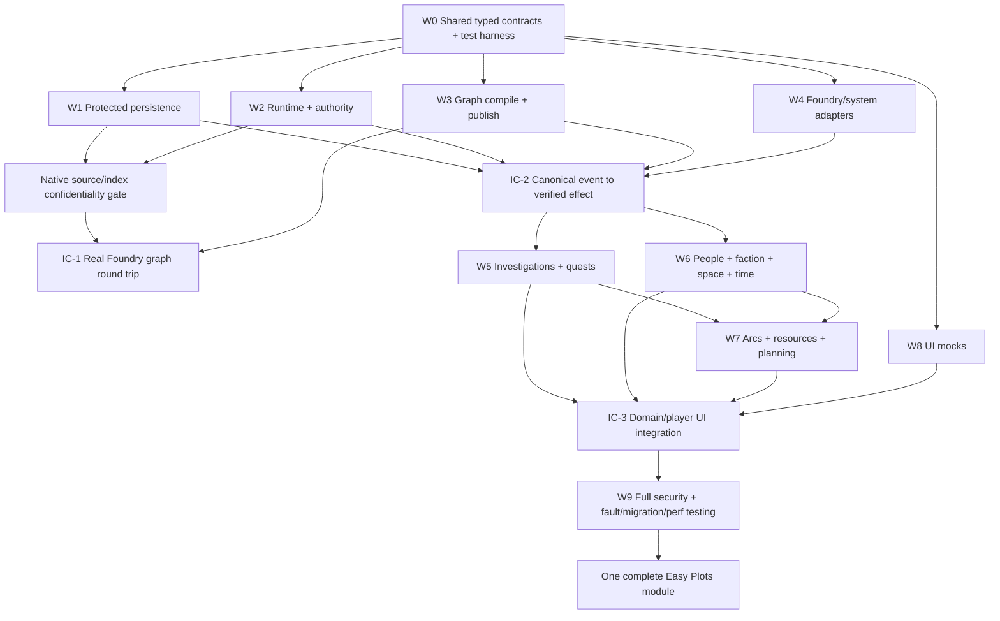

# Easy Plots — One Complete Module, Parallel Agent Contracts and Integration Batches

**Document:** EP-DELIVERY-0.2. **Binding scope:** all 125 decisions belong to one final deliverable. A batch is a development checkpoint, not a shipped MVP or deferred optional feature set.

## 1. Code ownership and architecture discipline

| Agent/workstream | Exclusive proposed source ownership | Exports consumed by others | Dependency gates |
|---|---|---|---|
| W0 Contract steward | `src/contracts`, `schemas`, `fixtures/contracts` | typed schemas, discriminated results, migrations | no privileged API without explicit authorization contract |
| W1 Foundry storage | `src/storage`, `src/platform/documents`, `src/platform/packs` | `NarrativeRepository`, `IndexResolver`, `MigrationRunner` | confidentiality native permission spike, bounded index proof |
| W2 Security and runtime | `src/security`, `src/runtime`, `src/runtime/recovery` | Auth, projection, dispatcher, effect coordinator, GM request lifecycle | trusted native origin proof, journal/recovery tests |
| W3 Graph/compiler | `src/graph`, `src/domains/plots/compiler` | typed graph evaluator, validator, publisher/activator | V1 contracts and secure source read adapter |
| W4 Native adapter | `src/platform/hooks`, `src/capabilities`, `src/platform/systems` | versioned capability registry and effect verification | exact v14/system feature probes |
| W5 Investigation/quests | `src/domains/knowledge`, `src/domains/investigation`, `src/domains/quests` | evidence, theories, milestones, quest projections | event/query and protected projection interfaces |
| W6 Living world | `src/domains/factions`, `src/domains/people`, `src/domains/spatial`, `src/domains/temporal` | faction agendas, identity/relations, time/space domain | stable reference, schedule and event interfaces |
| W7 Long-form orchestration | `src/domains/arcs`, `src/domains/resources`, `src/domains/blueprints`, `src/domains/simulation`, `src/domains/planning` | arc endings, continuity, resources, previews, GM plans | W1/W2/W3 contracts, no hypothetical native writes |
| W8 UI | `src/ui`, `static/styles`, `static/templates` | AppV2 GM workspace/player projection views | sanitized DTOs, mock data not protected source imports |
| W9 QA integration | `tests`, `tools`, `build`, module packaging | fixtures, chaos harness, release evidence | all workstream public contracts |

The table declares **ownership domains**, not one agent per workstream as a hard requirement. Several agents may work within a workstream if they use non-overlapping files and one integration owner. Parallel writing with mocks can start early; release-driving integration follows the contract dependency graph.

## 2. Dependency graph (contract readiness, not exclusive code-writing sequence)



## 3. Incremental batches and immediate debugging feedback

**B0 — Source contracts and Foundry security proof.** Establish schema validation, module skeleton, support matrix candidate, native document/index confidentiality test and actual user-origin request proof. W8 builds inert AppV2 mock screens concurrently; W5/W6/W7 draft provider fixtures with frozen contracts. B0 fails if a secure native player request pathway cannot be verified; no insecure temporary bypass can ship.

**B1 — Durable native identity/storage and graph authoring.** Implement bounded repository, graphs, Node/Edge typed authoring, draft persistence, validator and preflight. CI verifies round-trip on exact v14 target build, protected source visibility and lazy loads.

**B2 — Reactive execution end-to-end.** Add normalized native events, scoped routing, compiled graph evaluation, GM approvals, effect provider validation, journal-and-verify, separate publication/activation, failure injection. Cross-agent integration tests: eligible Hook, duplicated delivery, stale revision, lost ACK, GM disconnect.

**B3 — Player interaction and narrative knowledge.** Implement verified player intents, observer-specific knowledge, rumors, claim corrections, evidence, hypotheses, investigation boards, quest milestones, safe affordances. UI integrates only projected data. Adversarial leaks and oracle probing tested after each merge.

**B4 — Living world and campaign coordination.** Implement factions, relationships, NPC agendas and schedules, spatial graphs, system checks and encounters, temporal reconciliation, cross-plot dependencies, campaign endings/continuity. Each domain uses the same causal engine; no second scheduler or duplicated event-store.

**B5 — Planning, templates and resource lifecycle.** Implement blueprints/three-way merge, safe native resource materialization and provenance, GM cockpit, health, time/session planner, narrative foresight and simulation. All previews remain isolated from canonical writes.

**B6 — Complete UI, performance, repair and packaging.** Validate all 125 proposed acceptance scenarios, exact verified compatibility matrix, migration rehearsals, full adversarial security suite, co-GM restart/failover, accessible AppV2 workflows and single-module artifact. No partial feature release is treated as project completion.

Batches are not strictly serialized source development; they identify the earliest point at which code may be **integrated with real protected world state**. An agent may complete domain code sooner behind mock contracts.

## 4. Merge gate for each parallel agent

1. Exported file interfaces match exact frozen schema version and owner approval.
2. Full implementation files are delivered; unapproved placeholder behavior is rejected.
3. At least one success test plus failure/authorization test, with explicit expected native behavior.
4. Changed records map to Q/ADR and REQ IDs, plus `TEST-ADR-xxx` and suite cases.
5. No direct Prisma/SQLite/HTTP backend, browser worker service or remote server introduced.
6. GM-only and public projections reviewed; no protected metadata in player bundles or socket packets.
7. Code that touches native APIs records core/system tested versions and exact API surface.
8. Performance-sensitive changes report accessed partitions/cache size and budget behavior.
9. Native effect changes show pre-write journal transition and verification on lost ACK.
10. If migration or persisted schema changed, include old/new fixtures and recovery protocol.

## 5. Proposed repository layout

```text
easy-plots/
  module.json
  package.json
  src/
    bootstrap/                      # Foundry init/ready registration
    contracts/                      # Versioned interfaces, codec registry
    platform/{documents,packs,hooks,systems}/
    storage/{partitions,indices,migrations,journals}/
    security/{authority,intents,projections}/
    runtime/{events,scheduler,operations,recovery}/
    graph/{compiler,validators,publisher,activator}/
    capabilities/{native,system,registry}/
    domains/{plots,quests,knowledge,investigation,people,factions,spatial,temporal,encounters,arcs,resources,blueprints,simulation,planning}/
    ui/{gm,player,shared}/
    diagnostics/
  static/{templates,styles,lang}/
  tests/{contract,unit,foundry,e2e,security,chaos,bench,migration}/
  tools/{fixtures,release}/
  docs/{adr,spec,schemas,compatibility}/
```

This is **one deployable module**. Source folders establish boundaries but do not imply a network/service/process split.

## 6. One-module completion criteria

Release only when the full scope has meaningful Foundry integration coverage, not merely draft schemas. The `Full_125_Decision_Acceptance_Matrix.csv` defines 125 proposed scenario oracles; these must be expanded to runnable harnesses, assigned to agent owners, executed and linked to evidence artifacts. `TEST-ADR-xxx` status `Proposed` is never interpreted as `Passed`. Any genuine architectural change requires explicit decision amendment.
